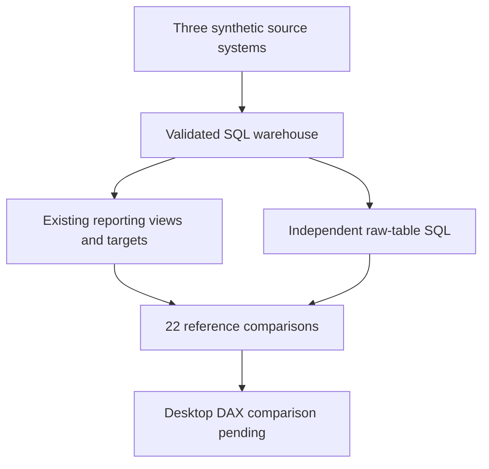
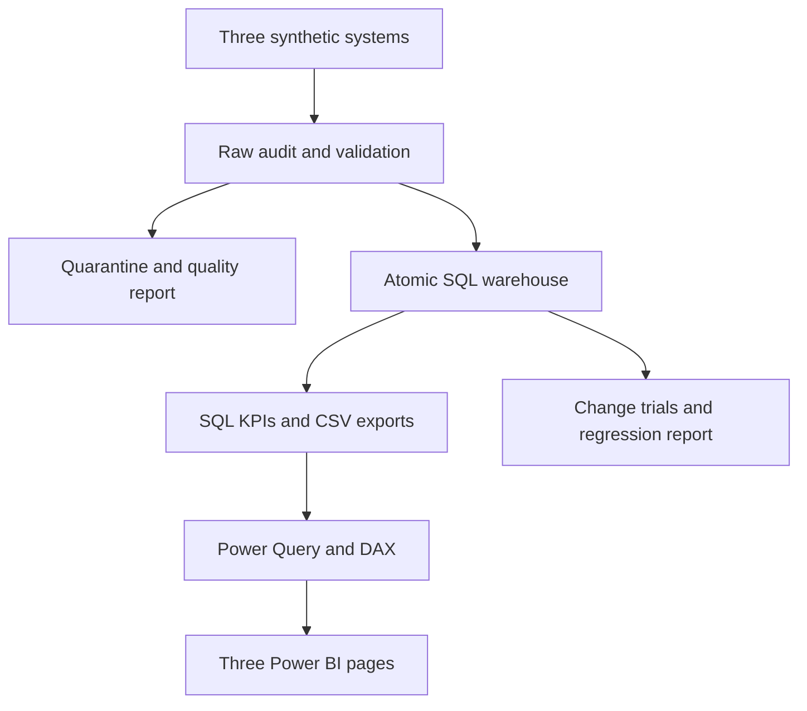

<p align="center"></p>

# CustomsDesk BI

**Customs Operations ETL, SQL Warehouse & Power BI Analytics**

**SYNTHETIC DATA · Independent student portfolio project · No Volvo affiliation**

Customs teams need a consistent view of shipments, authority queries and part classifications.
CustomsDesk BI integrates three simulated operational systems, preserves source lineage, quarantines
invalid records and calculates operational KPIs from a relational warehouse.

**Verification status (6 November 2026):** The GitHub Actions pipeline passed both its `unit` and
`postgres` jobs. The unit job reported **94 passed, 5 deselected**; the PostgreSQL verification
job reported **99 passed**. These are separate executions with overlapping test coverage, **not
193 distinct tests**. CI ran a PostgreSQL service container; this does not establish that the
local Windows/PostgreSQL workflow has run. Power Query M, DAX definitions, CSV exports and a
three-page Power BI report guide are included, but **Power BI Desktop execution is not verified**
and no `.pbix` file is supplied.

[](https://github.com/yusufthecoder474/CustomsDesk-BI/actions/workflows/ci.yml)


The numeric badges describe the [verified 6 November 2026 GitHub Actions run](https://github.com/yusufthecoder474/CustomsDesk-BI/actions/runs/42170271390); the workflow badge reflects the current workflow status.


## Current verified upgrade

**Latest hosted CI (6 November 2026):** 94 unit-job tests passed and 5 were deselected; the separate PostgreSQL verification job passed 99 tests. The two jobs completed successfully and uploaded `unit-evidence` and `postgres-evidence` artifacts. [See the CI run](https://github.com/yusufthecoder474/CustomsDesk-BI/actions/runs/42170271390).

**Earlier local enhancement run:** 97 tests passed and 2 PostgreSQL checks were skipped in the recorded environment. Package installation and wheel build succeeded in the recorded Linux environment. New-module lint passed, while full-project lint had previously reported issues (see [docs/EVIDENCE.md](docs/EVIDENCE.md)). Native Databricks, Power BI Desktop and Excel Desktop execution remain unverified. The historical local PostgreSQL limitation does not describe the newer hosted CI result.

All 22 authored DAX measure targets now reconcile to independent SQL that queries raw warehouse tables without the reporting views. This validates the SQL references; DAX execution remains pending. The three-page Power BI specification, response bands, relationship checks and explicit date/filter contexts are retained. No PBIX was supplied or created.



[Current evidence](docs/EVIDENCE.md) · [Exact independent SQL](reports/enhancement/independent_measure_queries.sql) · [Power BI build specification](powerbi/REPORT_LAYOUT.md)

```powershell
$env:PYTHONPATH = "src"
python -m customsdesk.measure_sql --database-url sqlite:///reports/current_upgrade/warehouse.sqlite
python -m pytest -q
```

First create that disposable SQLite database with the commands in docs/EVIDENCE.md; your existing .env and Docker volume must be retained.

## October 2026 enhancement — executed locally

| Check | Result |
|---|---|
| Full synthetic ETL | 55,004 source rows; 54,992 accepted |
| SQL KPIs | All 13 historical targets reproduced in fresh SQLite |
| DAX definitions | 22 preserved; referenced columns checked against schema |
| Relationship specifications | 11 checked for unique dimension keys and fact orphans |
| SQL measure/context targets | 38 prepared; actual DAX result cells remain empty |
| Local tests (October 2026) | 97 passed; 2 PostgreSQL checks skipped in that local run |
| Power BI Desktop | Not verified; no PBIX supplied |
| Hosted PostgreSQL CI (November 2026) | Verified separately: 99 tests passed |

Added a response-band Power Query column and the exact requested three-page [layout](powerbi/REPORT_LAYOUT.md). Current result files are in [reports/enhancement](reports/enhancement), including SQL targets and relationship checks. These are schema and SQL checks, not DAX-engine or Desktop validation. No PBIX was produced.

```powershell
$env:PYTHONPATH = "src"
python -m customsdesk.dashboard --database-url sqlite:///reports/enhancement/warehouse.sqlite
python -m pytest -q
```
First create that disposable SQLite warehouse using the manual checklist. For your existing PostgreSQL connection, use the ordinary CLI with your retained local configuration. No credentials or Docker volumes were changed here.

[Current verification](reports/enhancement/VERIFICATION.md) · [Windows/Power BI checklist](docs/MANUAL_VERIFICATION.md) · [Resume bullets](docs/VERIFIED_RESUME_BULLETS.md)

## What is implemented

- Configurable fixed-seed generator: shipment CSV, query JSON and part CSV, with a defect ledger.
- Validated ETL, immutable per-run raw records, checksums, quarantine reasons and reconciliation.
- Star schema with relational constraints/indexes, atomic snapshot replacement and fact idempotency.
- SQL KPIs, median via window functions, calendar-month throughput and month-over-month LAG.
- UTC response/SLA rules, business-calendar overlap and explicit unresolved-query handling.
- Isolated source-change trials, KPI comparisons and an intentionally detected breaking change.
- SQL-driven EDA, business insights, 16 dashboard-ready CSV exports.
- Power Query loader and table queries, **22 DAX measures**, theme and exact three-page visual mapping.
- Automated tests, separate unit/PostgreSQL CI jobs, Windows setup and interview materials.
- Safe .env loading, configurable ports, instance identity checks and credential-free diagnostics.
- One-click CMD/PowerShell verification with guarded disposable tests and timestamped evidence.



## One-click Windows verification

**Copy the updated project files into your existing project folder, preserving its local `.env`,
`.venv` and Docker volume. Then double-click `scripts\finish_windows.cmd`.**

Use the original project path (`D:\Downloads\CustomsDesk-BI\CustomsDesk-BI`) to keep Compose
ownership consistent. The workflow refuses to adopt a same-named project belonging to another folder.

The workflow creates/reuses Python 3.12's virtual environment, installs dependencies, checks Docker
Desktop, preserves local configuration, chooses a free loopback port (default **5434**) and preserves
the existing password; generates one only for a new configuration. It starts only this project's db service,
checks health and ownership, runs ETL/export, provisions a new guarded PostgreSQL test database,
runs all tests, reconciles SQLite/PostgreSQL KPIs and generates timestamped evidence.

CMD options (no PowerShell syntax needed):

```bat
scripts\finish_windows.cmd -DryRun
scripts\finish_windows.cmd -Troubleshoot
```

Full details: [Windows workflow](docs/WINDOWS_ONE_CLICK.md), [configuration/security](docs/CONFIGURATION_AND_SECURITY.md),
[non-destructive PostgreSQL recovery](docs/POSTGRES_TROUBLESHOOTING.md).
No script prunes resources, deletes a database/volume or modifies another project's containers.

## Explicit SQLite quick start

This local path works without Docker and is separate from PostgreSQL verification:

```powershell
py -3.12 -m venv .venv
.\.venv\Scripts\python.exe -m pip install -r requirements-dev.txt -e .
.\.venv\Scripts\python.exe -m customsdesk.cli demo --database sqlite
.\.venv\Scripts\python.exe -m pytest -q
```

On Linux use `python3 -m venv .venv`, `source .venv/bin/activate`, then the equivalent `python`
commands. `--database sqlite` deliberately selects SQLite even when local PostgreSQL configuration
exists. A failed PostgreSQL connection never silently falls back to SQLite.

## Primary PostgreSQL setup

Use the one-click workflow instead of entering password-bearing URLs. Compose publishes
`127.0.0.1:${CUSTOMSDESK_HOST_PORT:-5434}:5432`; internal port 5432 is unchanged. Both Python and
Compose load the project .env; standalone shell overrides have documented precedence. Network
connections must match configured host/port/user/database and the per-install identity marker.
Editing POSTGRES_PASSWORD alone does not reset an initialized volume's role password.

The Python orchestrator can also run on Linux with Docker: `python -m customsdesk.windows finish --root .`
after dependencies are installed. The local Windows/Compose workflow has not been verified here.
Do not point TEST_POSTGRES_URL at an existing database: tests require a newly created random test
name and matching guard token supplied by the workflow. CI has separate unit and PostgreSQL jobs,
both of which [passed on 6 November 2026](https://github.com/yusufthecoder474/CustomsDesk-BI/actions/runs/42170271390).

## Commands

```powershell
customsdesk generate --seed 474 --shipments 20000 --queries 30000 --parts 5000
customsdesk etl
customsdesk kpis
customsdesk export
customsdesk analyze
customsdesk regress
customsdesk demo
```

Generator distributions are configurable with `--config data/generator_config.json`; probabilities and rates are validated. Status order is OPEN, ASSIGNED, RESPONDED, CLOSED; priority order is HIGH, NORMAL, LOW.

All commands accept `--database-url`, `--data`, `--reports` and `--exports`. `demo` regenerates sources,
runs ETL, exports, EDA and isolated change trials. It replaces the analytical snapshot; raw audits
accumulate. Use a fresh database for one-run reconciliation. Run one ETL writer at a time.
`requirements-lock.txt` pins the dependency closure captured in the verification environment.

## Power BI

Start with [docs/POWER_BI_SETUP.md](docs/POWER_BI_SETUP.md), then [powerbi/REPORT_LAYOUT.md](powerbi/REPORT_LAYOUT.md).

1. Create parameters and fxLoad from powerbi/; choose PostgreSQL or CSV fallback.
2. Import named table queries, configure the documented star relationships and date roles.
3. Create measures from powerbi/measures.dax, import theme.json and assemble three pages.
4. Refresh and reconcile to data/exports/vw_kpis.csv and vw_monthly.csv.
5. Save CustomsDesk-BI.pbix locally. Complete reports/POWER_BI_VALIDATION.md after real execution.

Pages: Executive Operations Overview; Process Bottlenecks; Classification & Data Quality.
Power BI is the intended business dashboard. There is no substitute Streamlit dashboard.

## Data and definitions

Default inputs contain 20,000 shipments, 30,000 queries and 5,000 parts **before** duplicate/update
injections. The generator records all assumptions and defects. Values, authority identities, event
frequencies and country mix are simulated; none represent Volvo records or observed customs operations.
The cutoff is fixed at 2026-10-01 UTC for reproducibility. HS checking validates format only.
Read docs/KPI_DICTIONARY.md before interpreting any chart. Currency is synthetic USD.

## Measured results

**Hosted GitHub Actions, 6 November 2026:** 94 tests passed in the `unit` job with 5 deselected;
99 tests passed in the `postgres` job. Both jobs succeeded. These are **not additive unique-test counts**.
The two evidence artifacts were uploaded successfully.

**Earlier local evidence:** the enhanced SQLite run recorded 97 passed and 2 PostgreSQL checks
skipped; an earlier repair recorded 85 passed and 2 skipped. The original 43-pass/1-skip
baseline is also retained as historical evidence. The full 55,004-row synthetic input was
processed again in the recorded local run, with 54,992 accepted records, 13 SQL KPI values
reproduced and matching source checksum. All seven PowerShell scripts passed static grammar
parsing; this does not prove local Windows runtime execution. See
[FINAL_VERIFICATION_REPORT.md](FINAL_VERIFICATION_REPORT.md) and [docs/EVIDENCE.md](docs/EVIDENCE.md).

Historical baseline: reports/VERIFICATION.md for executed commands and environment; reports/latest_run.json for
run ID/checksums/timing and actual counts; reports/tests.xml for test evidence. The generated
RESULTS.md summarizes the verified build. Business findings come from SQL in reports/BUSINESS_INSIGHTS.md.
No cost savings, production users, real operational improvement or unexecuted dashboard results are claimed.

## Repository map

| Folder | Contents |
|---|---|
| src/customsdesk | Generator, validation, warehouse, ETL, SQL-driven EDA, regression and CLI |
| sql | PostgreSQL schema, views and example analytical queries |
| tests | Unit, integration, hand-calculated KPI and rollback checks |
| data/sample | Full reproducible synthetic inputs and injected-defect ledger |
| data/exports | Power BI-ready UTF-8 CSV snapshots |
| powerbi | M queries, DAX source, theme and visual layout |
| reports | Actual run/quality/regression/EDA/test evidence |
| docs | Dictionaries, setup, architecture, interview and publishing instructions |

## Limits and next steps

The hosted GitHub Actions pipeline **has** executed PostgreSQL verification successfully, but
local Windows/Docker setup and the one-click script have not been verified in the evidence cited
here. Power BI Desktop refresh and DAX-engine execution remain unverified. CI database coverage
does not establish production deployment or a validated local installation.

Dates/timestamps are persisted as normalized ISO text in the portable warehouse; duration fields
are numeric. The pipeline is a single-writer full snapshot, not production CDC, scheduling or
historical classification tracking. There is no holiday calendar, legal tariff verification,
currency conversion, authentication service or real source integration.

Next steps: verify the optional Windows one-click workflow (if desired), complete the Power BI
Desktop checklist, agree business calendars, add source contracts and incremental/history
handling, and validate with approved real data. The SQLite quick start above does **not** need Docker.

## License and publication

The repository is published at [github.com/yusufthecoder474/CustomsDesk-BI](https://github.com/yusufthecoder474/CustomsDesk-BI).
**No open-source license has been selected.** Public visibility alone is not a grant of reuse
permissions; see [LICENSE_DECISION.md](LICENSE_DECISION.md). The [publication guide](docs/GITHUB_PUBLISH.md)
is retained for reference but its pre-publication steps are historical.
