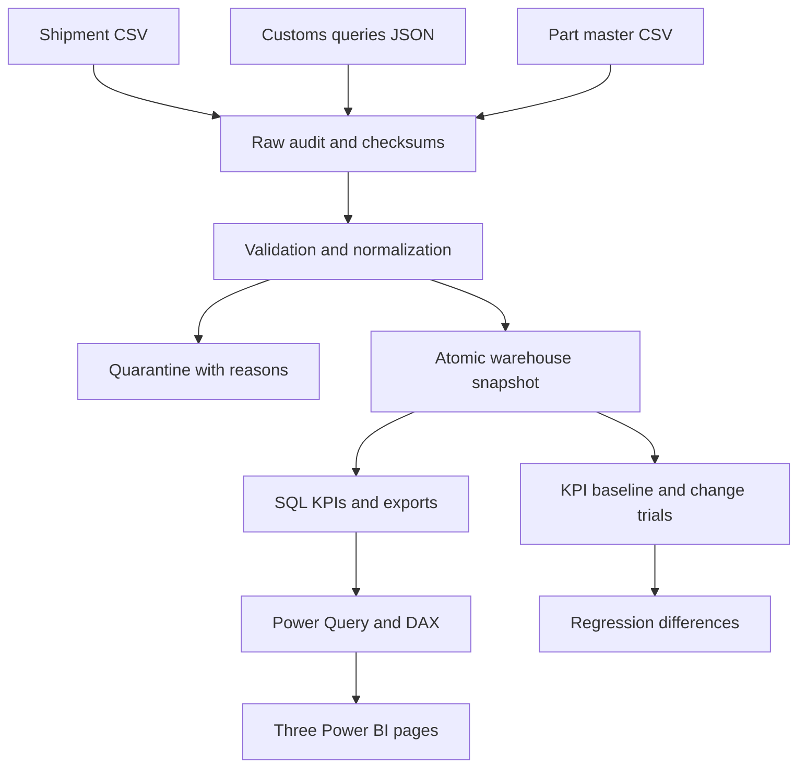
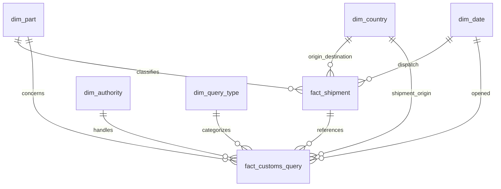

# Architecture

SYNTHETIC DATA only. This is an independent student project without Volvo affiliation.

The SQL foreign key between query and shipment enforces source integrity. Do **not** create that
fact-to-fact relationship in Power BI: use shared dimensions and single-direction filters instead.
Shipment grain: one accepted shipment ID. Query grain: one accepted query ID. Part grain: one current
accepted part ID/version. This prevents multiplying shipment values by the number of queries.

Python: deterministic generators, validation, business-calendar overlap, orchestration and export.
SQL: persisted facts/dimensions, integrity constraints, aggregation, median window, monthly LAG.
PostgreSQL is the deployment target. SQLite is an explicitly labeled local fallback, not evidence
of PostgreSQL execution. M and DAX are supplied source; Power BI Desktop verification remains pending.
